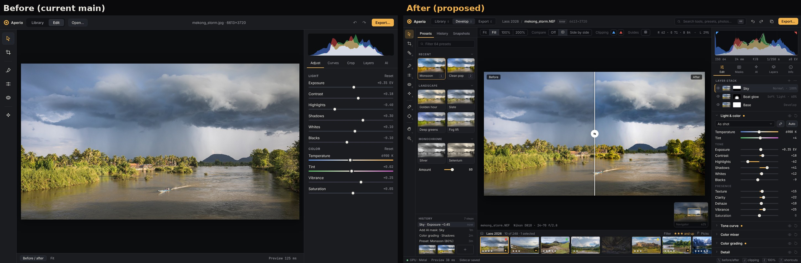
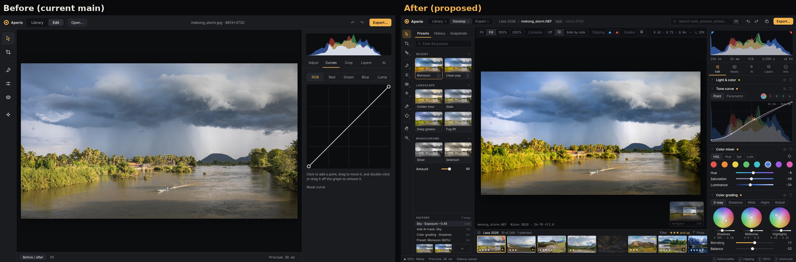
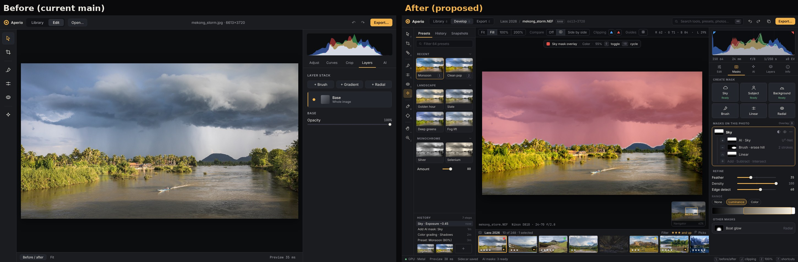
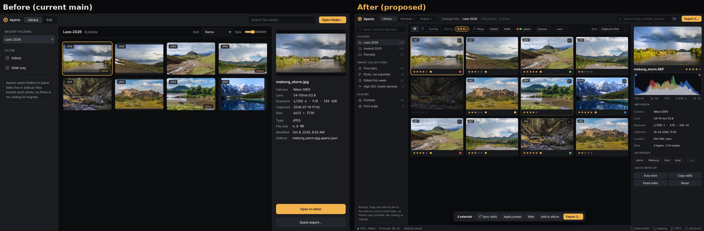
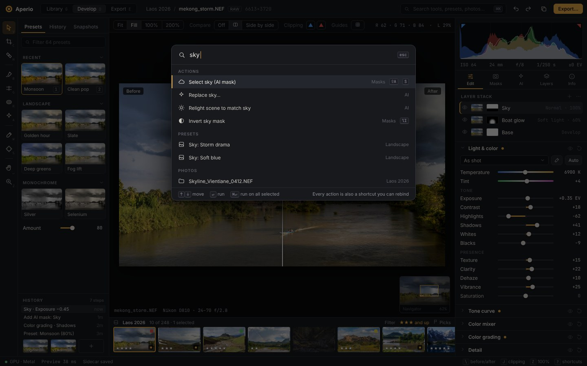

# Pro-grade UI redesign (proposal)

A design proposal for a denser, more capable editor, shown before anything is built. The "before" shots are the current `main` frontend running in a browser with the Tauri backend stubbed. The "after" shots are a static HTML prototype ([prototype.html](prototype.html)) that uses the same colors, type and amber accent, so Aperio keeps its own look.

| | |
|---|---|
|  | Develop screen |
|  | Tone curve, color mixer, color grading |
|  | Masks |
|  | Library and culling |
|  | Command palette |

## What changes

**Layout.** Library / Develop / Export modes in the top bar; a wider tool rail; a left panel for presets, history and snapshots; a view bar over the photo (zoom, compare, clipping, guides, pixel readout); a filmstrip with ratings and labels under the photo; a navigator.

**Right panel.** RGB + luma histogram with clipping indicators and EXIF line, then tabs: Edit, Masks, AI, Layers, Info. Edit holds collapsible sections with a changed dot, a visibility toggle and reset on each: Light & color, Tone curve, Color mixer, Color grading, Detail, Optics, Effects.

**Masks.** One place to create AI (sky, subject, background) and manual (brush, linear, radial) masks, combine them with add / subtract / intersect, refine (feather, density, edge detect) and limit by luminance or color range. Colored overlay toggled with `O`.

**Library.** Star ratings, pick/reject flags, color labels, smart collections, albums, filter chips, keywords, and batch actions (sync edits, apply preset, export N).

**Keyboard.** `⌘K` command palette for every action, preset and photo; single-key tools; visible shortcut hints.

## What is UI only and what needs engine work

UI only (the backend already supports it): mode bar, view bar, histogram upgrades, filmstrip, history list, collapsible sections, layer stack with mask thumbnails, mask overlay, command palette, shortcuts.

Needs new operations in `aperio-core` and the sidecar format: texture, clarity, dehaze; HSL color mixer; color grading wheels; parametric curve; detail and optics sections; blend modes; mask boolean composition and range masks; presets and snapshots; ratings, flags, labels, albums and keywords (stored in sidecars plus a small index, no catalog).

## Running the prototype

Serve this folder over HTTP (e.g. `python3 -m http.server`) with an `img/` folder of JPEGs named as in the `PHOTOS` list, then open `prototype.html?view=develop` (also `color`, `mask`, `library`, `palette`).

## Photo credits

Sample photos are from Wikimedia Commons; authors and full terms are on each file page. The screenshots containing them are shared under the same terms.

| File | License |
|---|---|
| [Landscape with stormy clouds and a pirogue on the Mekong at golden hour in Si Phan Don](https://commons.wikimedia.org/wiki/File:Landscape_with_stormy_clouds_and_a_pirogue_on_the_Mekong_at_golden_hour_in_Si_Phan_Don.jpg) | CC BY-SA 4.0 |
| [Icelandic Landscape near Neskaupstaður July 2014](https://commons.wikimedia.org/wiki/File:Icelandic_Landscape_near_Neskaupsta%C3%B0ur_July_2014.JPG) | CC BY-SA 4.0 |
| [Landscape during Laugavegur hiking trail 2-CA reduced](https://commons.wikimedia.org/wiki/File:Landscape_during_Laugavegur_hiking_trail_2-CA_reduced.jpg) | CC BY 3.0 |
| [Landscape with rainbow and the Old Bridge over the Nam Khan river in Luang Prabang Laos](https://commons.wikimedia.org/wiki/File:Landscape_with_rainbow_and_the_Old_Bridge_over_the_Nam_Khan_river_in_Luang_Prabang_Laos.jpg) | CC BY-SA 4.0 |
| [Ruisseau du Vialais - March 2021 - B](https://commons.wikimedia.org/wiki/File:Ruisseau_du_Vialais_-_March_2021_-_B.jpg) | CC BY 4.0 |
| [San Carlos Sonora landscape](https://commons.wikimedia.org/wiki/File:San_Carlos_Sonora_landscape.jpg) | CC BY-SA 4.0 |
| [Landscape of Luang Prabang with a temporary wooden footbridge](https://commons.wikimedia.org/wiki/File:Landscape_of_Luang_Prabang_with_a_temporary_wooden_footbridge.jpg) | CC BY-SA 4.0 |
| [Moraine Lake 17092005](https://commons.wikimedia.org/wiki/File:Moraine_Lake_17092005.jpg) | see file page |
