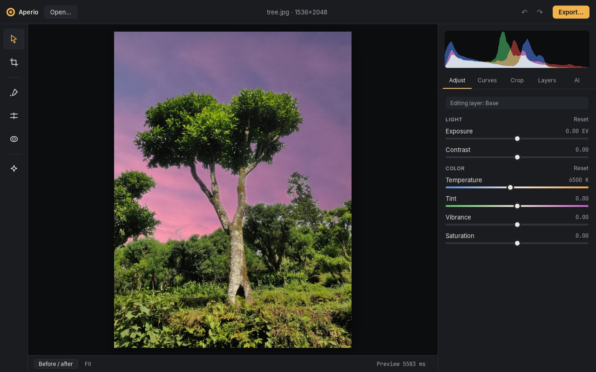
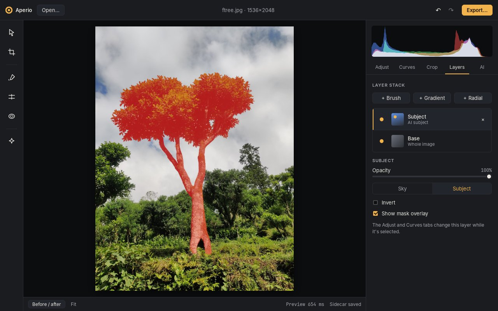

# Getting started with Aperio

This guide takes you from installing Aperio to exporting your first edited photo: open, adjust, mask, replace the sky, export. It should take about five minutes.



## 1. Install

Download the installer for your system from the [Releases](https://github.com/PostGuitarist/aperio/releases) page. Builds aren't signed with a paid developer certificate yet, so your system warns you the first time:

- **macOS (Apple Silicon):** open the `.dmg` and drag the Aperio icon onto the Applications folder next to it. The first time you open Aperio, macOS says it can't verify the app: click **Done**, go to **System Settings → Privacy & Security**, scroll down, and click **Open Anyway**. If macOS instead says Aperio "is damaged and can't be opened", run `xattr -dr com.apple.quarantine /Applications/Aperio.app` in Terminal and open it again.
- **Windows (64-bit):** run the `-setup.exe` or the `.msi`. If SmartScreen appears, click **More info → Run anyway**.
- **Linux:** make the `.AppImage` executable and run it, or install the `.deb` or `.rpm`. You need glibc 2.38 or newer (Ubuntu 24.04, Debian 13, Fedora 39 or later).

To build Aperio yourself instead, see [Building](../README.md#building) in the README.

## 2. Open a photo

Aperio starts in the **Library**. Click **Open folder…** (Ctrl/⌘+O) and choose a folder of photos. Aperio reads the folder where it is: there's no import step and no catalog. Click a photo to see its camera details, then **Open in editor**, or double-click it.

You can also open a single file from the editor with **Open…**. Aperio reads:

- RAW files from most cameras: CR2, CR3, NEF, ARW, RAF, ORF, RW2, DNG, PEF, SRW
- JPEG, PNG, and TIFF
- HEIC and HEIF, such as iPhone photos, using your system's own decoder. On Windows this needs Microsoft's **HEIF Image Extensions** and **HEVC Video Extensions** from the Microsoft Store. On Linux it needs libheif and its HEVC plugin (`sudo apt install libheif1 libheif-plugin-libde265` on Debian or Ubuntu).

Ctrl/⌘+1 switches to the Library and Ctrl/⌘+2 to the editor.

## 3. Adjust

The **Adjust** tab has exposure, contrast, highlights, shadows, whites, blacks, white balance (temperature and tint), vibrance, and saturation. **Curves** edits the tone curve for RGB together, for luminance only, or for red, green, and blue separately. **Crop** (C) crops and straightens.

**Noise** removes the grain from high-ISO photos, such as shots taken indoors or at night. Tick **AI denoise** (it needs the AI models, see step 5), then set **Amount** and **Keep detail**. Denoise runs once on the full-size photo in the background, which can take a few minutes on a laptop; the status bar shows its progress, and you can keep editing while it works. After that, moving its sliders is quick.

Press **\\** or click **Before / after** to compare with the original. Undo and redo are Ctrl/⌘+Z and Ctrl/⌘+Shift+Z.

Every change is saved as you go, to a small text file next to the photo (`photo.jpg.aperio.json`). Your original file is never changed. Copy the photo and its sidecar together and the edit goes with them. The format is documented in [sidecar-format.md](sidecar-format.md).

## 4. Mask part of the photo

Masks let you adjust one part of the photo. Each mask lives on its own **layer**, which has its own adjustments and opacity. Add one from the **Layers** tab or the tool rail on the left:

- **Brush** (B): paint where the layer applies, or erase.
- **Gradient** (G): a linear fade, such as darkening a bright sky.
- **Radial** (R): an ellipse, such as lifting a face or a flower.

Drag the handles on the photo to place the mask. While a layer is selected, the Adjust and Curves tabs change that layer only.



## 5. Let AI find the sky or subject

Open the **AI** tab (A). The first time, click **Download models**. That's about 520 MB, including the denoise model, downloaded once and checked before use. The models run on your computer, and your photos never leave it.

Then, under **Select**, click **Sky**, **Subject**, or **Background**. Each adds a layer masked to that part of the photo. Aperio starts working out these masks in the background as soon as a photo opens, so they're usually ready when you click. Tick **Show mask overlay** in the Layers tab to see exactly what's selected, and **Invert** to flip it.

**Faster subject masks (optional).** The standard subject model takes 15–20 seconds on a typical CPU. Open **Models** at the bottom of the AI tab to download a fast subject model, which takes about 1.5 seconds with slightly softer edges. Read the note next to it first: its weights don't state a license and were trained on data licensed for non-commercial research only. Once it's downloaded, subject layers get a **Best / Fast** switch.

## 6. Replace the sky

In the AI tab, click **Replace sky…** and choose a photo of a sky. Aperio puts it behind the AI sky mask and fits it above the horizon. You can change its position, zoom, and exposure in the layer's settings.

Aperio also adds a **Match scene to sky** layer that shifts the rest of the photo's colour and light toward the new sky, tints water and reflections with it, and softens the horizon with a little of its haze. Its **Match lighting**, **Reflections**, and **Horizon haze** sliders control each part; set them to zero, or turn the layer off, to keep the original light.

## 7. Export

Click **Export…** (Ctrl/⌘+E). Choose:

- **Format:** JPEG for sharing, PNG, or 16-bit TIFF for printing or further editing.
- **Resize** to a long edge, or keep full size.
- **Sharpening** for screen or print.
- **Metadata:** by default, everything except your location is copied into the exported file.
- **Save to** and **File name**: `{name}` stands for the original's name.

Exports are written as new files. The original stays as it was.

## Command line

The `aperio` tool renders a photo with its sidecar edits, and manages the AI models:

```sh
aperio render photo.CR2 photo.jpg   # export with the edits in photo.CR2.aperio.json
aperio models                       # which AI models are downloaded
aperio models download              # download the standard models
aperio models bench photo.jpg       # time the AI masks and denoise, and show where they ran
```

## Troubleshooting

- **AI buttons do nothing, or a layer says it was skipped:** the models aren't downloaded yet. Open the AI tab and click **Download models**.
- **A HEIC photo won't open:** install your system's HEIC support (see step 2).
- **AI masks are slow:** on macOS, sky masks run on the GPU, but subject masks run on the CPU. Linux runs both on the CPU. Try the optional fast subject model, or open the photo and give the background work a few seconds before you add the mask.
- **Denoise is slow:** it runs on every pixel of the full-size photo, so a 24-megapixel photo takes a few minutes on a laptop CPU, less on a GPU. It only runs again when the photo changes, not when you move its sliders.
- **Something looks wrong on screen:** set `APERIO_AI_CPU=1` to rule out the GPU for AI masks, and [open an issue](https://github.com/PostGuitarist/aperio/issues) with the photo type and your system.

To add your own effects or masks, see [Writing a plugin](plugins.md).
